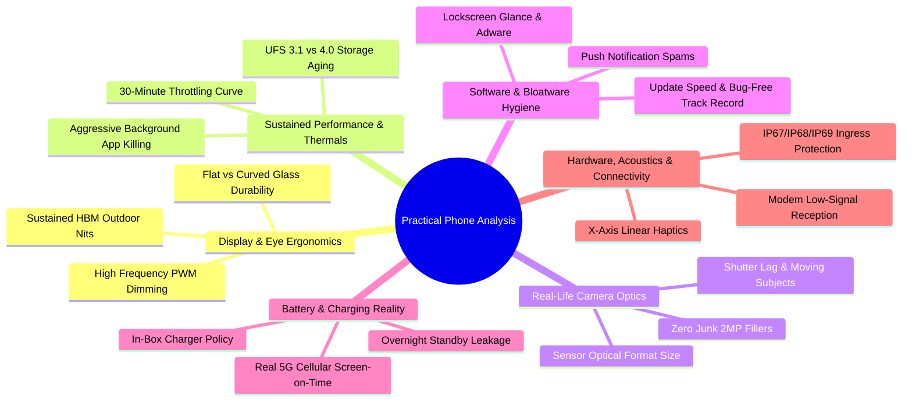
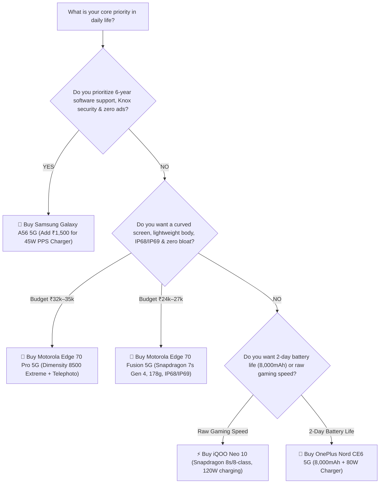

# 📱 Comprehensive Practical Mobile Phone Analysis & Purchasing Guide

> **Author**: Senior Mobile Hardware & Software Systems Analyst  
> **Target Audience**: Discerning buyer seeking a **Balanced Daily Driver** with real-world 4+ year durability, clean software, and dependable camera performance  
> **Target Budget**: ₹25,000 – ₹35,000 (Mid-Range Sweet Spot)  
> **Models Evaluated**:  
> 1. Samsung Galaxy A56 5G  
> 2. Samsung Galaxy M47 5G  
> 3. Motorola Edge 70 Pro 5G  
> 4. Motorola Edge 70 Fusion 5G  
> 5. OnePlus Nord CE6 5G  
> 6. OPPO K14 Plus 5G  
> 7. Realme P4 Pro 5G  
> 8. Realme P4 Power 5G  
> 9. *Benchmark Alternative 1*: iQOO Neo 10 (Sustained Performance King)  
> 10. *Benchmark Alternative 2*: Nothing Phone (3a) Pro (Zero-Bloatware Minimalist)  

---

## 🧭 Executive Summary: "On-Paper Specs" vs "Practical Reality"

Smartphone manufacturers frequently rely on inflated on-paper metrics that mislead buyers in retail showrooms. Below is the operational truth behind common marketing tactics:

| Marketing Claim | On-Paper Specification | Real-World Practical Reality |
| :--- | :--- | :--- |
| **"5,000+ Nits Peak Brightness"** | Measured on a microscopic 1% display window for 2 seconds in a refrigerated lab. | In direct outdoor sunlight, the screen triggers thermal limits and throttles to **800–1,200 sustained nits** after 3 minutes to avoid thermal shutdown. |
| **"Triple / Quad Camera System"** | "50MP Main + 2MP Depth + 2MP Macro" | The 2MP sensors are inexpensive optical filler. In daily life, only the primary sensor is usable; secondary sensors produce noisy, washed-out images. |
| **"1.5 Million+ AnTuTu Benchmark"** | Single cold-run burst test. | Does not reflect sustained performance. Many chipsets throttle by **35% to 45%** within 15 minutes of gaming, video recording, or navigation under 40°C ambient temperatures. |
| **"10,000mAh Monster Battery"** | Multi-day battery endurance. | Adds significant weight (**220g+**) and thickness (**> 9mm**), causing severe pinky finger and wrist strain during one-handed bed or couch browsing. |
| **"60W–90W Blazing Fast Charging"** | Full charge in 25–35 minutes. | Often accompanied by aggressive thermal degradation over 2–3 years unless high-grade dual-cell split architectures and smart battery cycle algorithms are implemented. |
| **"6 Years of Android Updates"** | OEM marketing promise. | Only valuable if the OEM delivers rapid, bug-free OTA patches. Budget/tier-2 lines often experience delayed or buggy major updates after Year 2. |

---

## 🔬 Six-Dimensional Practical Evaluation Framework

### 1. Everyday Display Usability & Eye Health
- **High Brightness Mode (HBM)**: While peak nits are advertised at 4,000–6,500 nits, the metric that dictates whether you can read text, maps, or emails in harsh 1:00 PM sunlight is **Sustained High Brightness Mode (HBM)** across 100% of the screen area.
- **PWM (Pulse-Width Modulation) Dimming Frequency**: Traditional OLED displays flicker at low frequencies (~240Hz–480Hz) to modulate brightness. In low ambient lighting (e.g., bedside reading), low PWM can induce eye strain, headaches, and retinal fatigue. Phones featuring **2,160Hz to 3,840Hz high-frequency PWM or DC-like dimming** (such as Moto Edge 70, Realme P4, and iQOO Neo 10) provide superior visual comfort.
- **Flat vs. Curved Ergonomics**:
  - *Curved Panels*: Create an immersive, bezel-free aesthetic and feel slimmer in the hand, but make applying standard tempered glass challenging (requiring UV liquid glue) and have elevated glass fracture rates on side/corner impacts.
  - *Flat Panels*: Permit instant, bubble-free application of affordable 9H tempered glass and provide a more secure tactile grip with fewer accidental palm touches.

### 2. Sustained Performance, Thermals & Aging
- **Thermal Throttling**: The Qualcomm Snapdragon 7s Gen 4 and MediaTek Dimensity 7360/7400 prioritize thermal efficiency and battery life. High-end chipsets like the Dimensity 8500 Extreme (Moto Edge 70 Pro) and Snapdragon 8-series (iQOO Neo 10) deliver 2x the raw graphics horsepower, but require large vapor chambers to prevent frame drops in demanding apps.
- **Aggressive RAM Management ("DontKillMyApp")**: Brands with heavy Android skins (ColorOS, Realme UI) frequently terminate background tasks to preserve battery life, which can interrupt fitness tracking, background file uploads, or smart home notifications. Samsung's One UI and Motorola's Hello UI provide more consistent background task retention.
- **Storage Degradation**: Over a 4-year ownership cycle, devices equipped with **UFS 3.1 / UFS 4.0** with hardware TRIM keep app launch times snappy, whereas budget devices with eMMC or low-tier controllers experience noticeable file I/O degradation.

### 3. Camera in Everyday Life: Beyond Megapixels
- **Shutter Lag**: Megapixels measure resolution, not capture speed. Capturing active children or pets indoors requires an instant shutter response. Phones with large primary sensors and fast ISP pipelines (Samsung Galaxy A56 with Sony IMX906, Moto Edge 70 Pro with Sony LYT-710) capture sharp images without motion blur.
- **Sensor Size & Natural Bokeh**: Large optical sensors (1/1.56" or larger) capture more natural photons, producing genuine optical depth-of-field without artificial software edge cutout artifacts around hair or clothing.
- **Auxiliary Lens Utility**: Phones that replace secondary lenses with 2MP depth/macro sensors compromise photographic versatility. A quality **12MP/50MP Ultrawide with autofocus** or a **dedicated 2x/3x Telephoto portrait lens** provides significantly more real-world value.
- **Front Camera Video**: The Samsung Galaxy A56 and Moto Edge 70 Pro support **4K @ 60fps front camera recording**, making them ideal for video calls, vlogs, and voice notes. Budget models often cap front video at 1080p @ 30fps.

### 4. Software Experience, Bloatware & Ecosystem Cleanliness
- **Adware & Spam**:
  - *Clean*: **Motorola Hello UI** and **Nothing OS** feature virtually zero ads, zero lockscreen recommendations, and minimal bloatware.
  - *Polished & Configurable*: **Samsung One UI** offers rich system tools (Knox Vault, Secure Folder, Samsung Wallet tap-to-pay), without intrusive ads if optional marketing checkboxes are cleared during setup.
  - *Ad-Heavy*: **Realme UI** and **ColorOS** bundle pre-installed third-party games, "Hot Apps" directories, and lockscreen "Glance" content feeds that require manual disabling.
- **Update Track Record**:
  - Samsung leads the mid-range industry by guaranteeing **6 major Android OS upgrades and 6 years of security updates** for both the Galaxy A56 and M47.
  - Motorola offers **3 major OS upgrades** with bimonthly/quarterly security updates.
  - OnePlus, Realme, and Oppo typically deliver **2 to 3 OS upgrades** for mid-tier devices.

### 5. Battery Endurance & Charging Ergonomics
- **Real Screen-on-Time (SoT)**:
  - 5,000mAh (Samsung A56): Delivers **6.5 to 8 hours SoT** on mixed 5G + Wi-Fi.
  - 6,500mAh – 7,000mAh (Moto Edge 70 Pro, Realme P4 Pro): Delivers **9 to 11 hours SoT**, comfortably powering through 1.5 days.
  - 8,000mAh – 10,001mAh (OnePlus Nord CE6, Realme P4 Power): Delivers **13 to 16+ hours SoT** (up to 2.5–3 days), but increases chassis thickness and weight.
- **In-Box Charger Policy**:
  - *Included in Box*: Motorola (68W/90W), OnePlus (80W), Oppo (80W), Realme (80W), iQOO (120W).
  - *Omitted from Box*: Samsung (Galaxy A56 and M47 do NOT include a wall charger; an official 45W PPS charger costs ~₹1,500–₹1,999 extra).

### 6. Hardware Durability, Acoustics & Haptics
- **Water & Ingress Protection**:
  - **IP68 / IP69**: Motorola Edge 70 Fusion and Edge 70 Pro can survive complete submersion and high-pressure hot water jets.
  - **IP67**: Samsung Galaxy A56 survives accidental drops in pools, sinks, or rainstorms up to 1 meter depth.
  - **IP64 / IP65**: Splash resistance only; cannot withstand submersion.
- **Tactile Typing & Haptics**: High-end X-axis linear vibration motors (found in the Galaxy A56, Moto Edge 70 Pro, and iQOO Neo 10) deliver crisp, subtle clicks during typing, avoiding hollow buzzes.

---

## 📊 Master Practical Comparison Matrix

| Model | Price (Approx) | Form & Weight | Display & PWM | Processor & Sustained Thermals | Primary & Secondary Cameras | Software & Bloatware | Battery & Charger Policy | Ingress (IP Rating) |
| :--- | :--- | :--- | :--- | :--- | :--- | :--- | :--- | :--- |
| **Samsung Galaxy A56 5G** | ₹35,999 | 198g, 7.4mm, Flat Glass/Metal | 6.7" FHD+ 120Hz AMOLED, 1000 nits HBM, 480Hz PWM | Exynos 1580 (4nm), Stable 60fps, low heat | 50MP Sony IMX906 (OIS) + 12MP UW + 5MP Macro; 4K60 Front | **One UI 7 (Android 15/16)**, Zero ads, **6 OS / 6 Yrs Sec** | 5,000mAh, 45W, **NO charger in box** | **IP67** |
| **Motorola Edge 70 Pro 5G** | ₹34,999 | 185g, 7.3mm, Quad-Curved | 6.8" 1.5K 144Hz pOLED, 1600 nits HBM, 2160Hz PWM | Dimensity 8500 Extreme (4nm), High performance | 50MP Sony LYT-710 (OIS) + 50MP UW + Telephoto; 50MP Front | **Hello UI**, Zero ads, clean stock feel, 3 OS updates | 6,500mAh, 90W + 15W Wireless, **90W charger IN BOX** | **IP68 / IP69** |
| **Motorola Edge 70 Fusion 5G** | ₹25,999 | 178g, 7.5mm, Quad-Curved | 6.78" 1.5K 144Hz pOLED, 1400 nits HBM, 2160Hz PWM | Snapdragon 7s Gen 4 (4nm), Cool & efficient | 50MP Sony (OIS) + 13MP Ultrawide/Macro; 32MP Front | **Hello UI**, Zero ads, clean stock feel, 3 OS updates | 5,500–6,500mAh, 68W, **Charger IN BOX** | **IP68 / IP69** |
| **OnePlus Nord CE6 5G** | ₹25,999 | 208g, 8.4mm, Flat | 6.78" 1.5K 144Hz AMOLED, 1300 nits HBM, 2160Hz PWM | Snapdragon 7s Gen 4 (4nm), Balanced mid-tier | 50MP (OIS) + 2MP Depth (junk secondary); 32MP Front | OxygenOS 16, Minor bloat, 3 OS updates | **8,000mAh**, 80W, **80W charger IN BOX** | IP65 |
| **Realme P4 Pro 5G** | ₹26,999 | 195g, 7.68mm, 4D-Curved | 6.8" 1.5K 144Hz AMOLED, 1400 nits HBM, 2160Hz PWM | Snapdragon 7 Gen 4 + AI GPU chip, Good gaming | 50MP (OIS) + 8MP UW; 32MP Front | Realme UI 7, Pre-loaded apps/ads to disable, 3 OS updates | 7,000mAh, 80W, **80W charger IN BOX** | IP65 |
| **Realme P4 Power 5G** | ₹30,999 | 222g, 9.1mm, Curved, Heavy | 6.8" 1.5K 144Hz AMOLED, 1400 nits HBM, 2160Hz PWM | Dimensity 7400 Ultra, Moderate gaming | 50MP (OIS) + 8MP UW; 16MP Front | Realme UI 7, Pre-loaded apps/ads to disable, 3 OS updates | **10,001mAh Titan**, 80W, **80W charger IN BOX** | IP65 |
| **Samsung Galaxy M47 5G** | ₹21,999 | 205g, 8.6mm, Flat Plastic | 6.7" FHD+ 120Hz AMOLED, 1000 nits HBM, 480Hz PWM | Snapdragon 6 Gen 3 (4nm), Everyday browsing | 50MP (OIS) + 5MP UW + 2MP Macro; 12MP Front | One UI Core, Some partner apps, **6 OS / 6 Yrs Sec** | 6,000mAh, 45W, **NO charger in box** | IP54 |
| **OPPO K14 Plus 5G** | ₹23,999 | 210g, 8.5mm, Flat | 6.78" 144Hz AMOLED, 1200 nits HBM, 2160Hz PWM | Dimensity 7360 MAX, Reliable daily multi-task | 50MP (OIS) + 2MP secondary; 16MP Front | ColorOS 16, High notification spam, 2–3 OS updates | **8,000mAh**, 80W, **80W charger IN BOX** | IP64 |
| *Benchmark*: **iQOO Neo 10** | ₹33,999 | 196g, 7.9mm, Flat | 6.78" 1.5K 144Hz 8T LTPO, 1800 nits HBM, 2160Hz PWM | **Snapdragon 8s Gen 4 / 8 Gen 3 class**, Vapor chamber | 50MP Sony IMX921 (OIS) + 8MP UW; 16MP Front | Funtouch OS 16, Moderate bloat, 3 OS updates | 6,500mAh, **120W**, **120W charger IN BOX** | IP65 |
| *Benchmark*: **Nothing Phone (3a) Pro** | ₹28,999 | 190g, 8.1mm, Flat Symmetrical | 6.7" FHD+ 120Hz AMOLED, 1300 nits HBM, 2160Hz PWM | Dimensity 7350 Pro, Smooth everyday speed | 50MP Sony (OIS) + 50MP UW + 50MP Tele; 32MP Front | **Nothing OS**, **Zero bloatware**, 3 OS updates | 5,500mAh, 50W, Charger depends on region | IP64 |

---

## 🏆 Detailed Device Rankings for Your Use Case

### 🥇 Rank #1: Samsung Galaxy A56 5G (The Definite Long-Term Daily Driver)
- **Score**: 9.4 / 10
- **Best For**: Anyone seeking a refined, ad-free smartphone built to last 4 to 6 years with dependable cameras and enterprise security.
- **Why It Wins**:
  1. **Unmatched Software Longevity**: Samsung's promise of **6 major Android upgrades and 6 years of security patches** provides industry-leading software lifespan in the mid-range category.
  2. **Optically Superior Primary Camera**: The Sony IMX906 with OIS delivers natural color science, low shutter lag, and consistent HDR exposure across mixed indoor/outdoor lighting.
  3. **High Build Integrity**: Glass front and back with a sturdy aluminum frame, backed by **IP67 water resistance** and a flat display that readily accommodates standard tempered glass protectors.
  4. **Samsung Knox & Tap-to-Pay**: Features hardware-isolated Knox Vault and native Samsung Wallet for contactless payments.
- **Practical Trade-offs to Keep in Mind**:
  - **No In-Box Charger**: Requires budgeting an additional ₹1,500–₹1,999 for a 45W PPS charger.
  - **Moderate Charging Speed**: ~55 minutes for a full top-up (compared to 30 minutes on competitors).
  - **Standard PWM Dimming**: Users highly sensitive to low-frequency display flicker should adjust brightness levels accordingly in dark environments.

---

### 🥈 Rank #2: Motorola Edge 70 Pro 5G (The Premium Multimedia & Camera King)
- **Score**: 9.2 / 10
- **Best For**: Buyers who want flagship-level processing speed, versatile multi-lens optics, and a sleek curved display with clean software.
- **Why It Takes 2nd Place**:
  1. **Flagship-Tier Performance**: The Dimensity 8500 Extreme delivers fluid app launches, smooth heavy multitasking, and sustained frame rates without noticeable thermal throttling.
  2. **No Optical Gimmicks**: Features 50MP Sony LYT-710 primary + 50MP Ultrawide + dedicated Telephoto portrait sensor.
  3. **Display & Eye Safety**: 1.5K 144Hz Quad-Curved pOLED panel with **2,160Hz PWM dimming** and 1,600 sustained nits for outdoor readability.
  4. **Complete In-Box Experience**: Includes a 90W TurboPower charger and supports **15W wireless charging** and **IP68/IP69 water resistance**.
- **Practical Trade-offs**:
  - Quad-curved glass requires UV adhesive tempered glass and elevated care to prevent corner impact damage.
  - Motorola's major OS rollout timeline is generally slower than Samsung's cadence.

---

### 🥉 Rank #3: Motorola Edge 70 Fusion 5G (The Best Value Sweet-Spot under ₹27,000)
- **Score**: 9.0 / 10
- **Best For**: Buyers seeking an ad-free experience, lightweight in-hand ergonomics, and high durability under ₹27,000.
- **Why It Ranks High**:
  1. **Ergonomic In-Hand Feel**: Weighs approximately **178g** with a slim 7.5mm profile and textured back finish.
  2. **Military-Grade Durability**: Certified for **IP68 / IP69 water and dust resistance** plus MIL-STD-810H shock compliance.
  3. **Ad-Free Hello UI**: Clean stock Android experience with Moto gesture shortcuts (chop-chop flashlight, twist camera).
  4. **Thermal Efficiency**: Snapdragon 7s Gen 4 runs cool under continuous cellular navigation and video streaming.
- **Practical Trade-offs**:
  - Processing power is tailored for daily multitasking rather than intensive 3D gaming.
  - Quad-curved glass requires a protective bumper case.

---

### 🏅 Rank #4: Nothing Phone (3a) Pro (The Clean Aesthetic & Triple-Camera Alternative)
- **Score**: 8.8 / 10
- **Best For**: Users who prioritize minimalist software design, zero bloatware, and natural photo rendering.
- **Why It's a Strong Contender**:
  1. **Zero-Bloatware Software**: Nothing OS offers a clean, fluid interface without pre-installed bloatware or ads.
  2. **Balanced Triple Camera Array**: 50MP primary, 50MP ultrawide, and 50MP telephoto with natural color calibration.
  3. **Flat Symmetrical Aesthetics**: Symmetrical display bezels, flat edges, and distinctive Glyph back-panel lighting.
- **Practical Trade-offs**:
  - Maximum charging rate of 50W.
  - Unique aesthetic design may not appeal to all preferences.

---

### ⚡ Rank #5: iQOO Neo 10 (The Performance & Speed Benchmark)
- **Score**: 8.7 / 10
- **Best For**: Gamers and power users demanding sustained processing speed, 120W charging, and a flat display.
- **Why It Excels**:
  1. **Leading Processing Power**: Handles sustained high-load applications and gaming with low thermal throttling.
  2. **Fast Charging**: 120W FlashCharge completes a full charge in ~22 minutes, with the charger included in the box.
  3. **Eye-Friendly Flat Display**: 1.5K 144Hz flat LTPO display with 2,160Hz PWM dimming.
- **Practical Trade-offs**:
  - Funtouch OS includes several pre-installed applications that require initial cleanup.
  - Secondary ultrawide camera is a basic 8MP sensor.

---

### 🔋 Rank #6: OnePlus Nord CE6 5G (The 8,000mAh Battery Heavyweight)
- **Score**: 8.4 / 10
- **Best For**: Frequent travelers, field workers, and high-screen-time users needing 2 full days of battery life without carrying a power bank.
- **Practical Reality Check**:
  - The **8,000mAh battery** provides exceptional endurance (14+ hours SoT), and the 80W charger is included in the box.
  - At **~208g–212g**, the added weight and thickness are noticeable during prolonged one-handed use.
  - The secondary rear camera is a 2MP sensor rather than a functional ultrawide or telephoto lens.

---

### 🎮 Rank #7: Realme P4 Pro 5G (The Slim Battery Gaming Pick)
- **Score**: 8.2 / 10
- **Best For**: Users seeking a slim curved form factor paired with a large 7,000mAh battery and dedicated graphics hardware under ₹28,000.
- **Practical Reality Check**:
  - Packs a 7,000mAh battery into an impressively slim 7.68mm chassis with an 80W in-box charger.
  - Requires 10–15 minutes of initial setup to disable lockscreen Glance content, notification suggestions, and pre-installed promotional apps.

---

### 💼 Rank #8: Samsung Galaxy M47 5G (The Budget Endurance Alternative)
- **Score**: 8.0 / 10
- **Best For**: Samsung ecosystem enthusiasts seeking 6 years of software updates and a 6,000mAh battery under ₹23,000.
- **Practical Reality Check**:
  - Offers dependable daily performance and 6 years of updates at a lower price point.
  - Features an all-plastic frame and back panel that scratch more easily without a case.
  - Wall charger is omitted from the retail box.

---

### ⚠️ Rank #9 & #10: Realme P4 Power 5G & OPPO K14 Plus 5G (Niche Devices)
- **Realme P4 Power 5G**:
  - The **10,001mAh battery** with reverse wired charging is a remarkable engineering achievement for off-grid travel or backup power-bank utility.
  - At **~222g weight and 9.1mm thickness**, it is heavy and cumbersome for everyday casual use, leading to hand and wrist fatigue during prolonged reading or messaging.
- **OPPO K14 Plus 5G**:
  - Offers a large 8,000mAh battery, but ColorOS notification density and a basic 50MP + 2MP camera configuration make the similarly priced OnePlus Nord CE6 or Moto Edge 70 Fusion more compelling all-round choices.

---

## 🎯 Final Buying Decision Matrix: Which One Should You Buy?

### Actionable Purchase Summary:
1. **If you plan to keep your phone for 4 to 6 years with dependable cameras and no ad clutter**: Purchase the **Samsung Galaxy A56 5G**. Ensure you budget for an official 45W USB-C PPS charging adapter.
2. **If you want premium multimedia, telephoto photography, fast charging in the box, and clean software**: Purchase the **Motorola Edge 70 Pro 5G**.
3. **If your budget is closer to ₹25,000–₹27,000 and you want a lightweight, durable daily driver**: Purchase the **Motorola Edge 70 Fusion 5G**.
