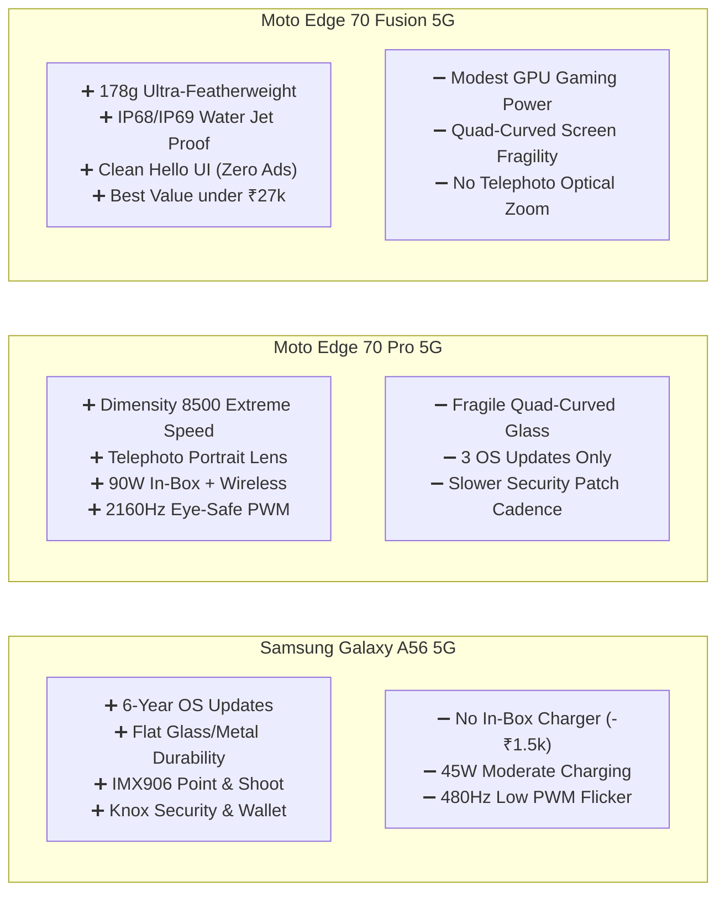

# 🏆 Top 3 Smartphone Head-to-Head Practical Comparison

> **Comprehensive Comparative Analysis**: Side-by-side evaluation of the 3 highest-ranking smartphones for a **Balanced Daily Driver** in the ₹25,000 to ₹35,000 price segment.  
> **Color-Coding Key**:  
> - 🟢 **[BEST IN CLASS / CATEGORY WINNER]** &rarr; Marked with green indicator; superior real-world performance.  
> - 🟡 **[STRONG RUNNER-UP]** &rarr; Very competitive; completely viable for daily use.  
> - 🔴 **[PRACTICAL DRAWBACK / LIMITATION]** &rarr; Noticeable compromise or extra hidden expense.

---

## 📊 Master Side-by-Side Comparison Table

| Practical Evaluation Dimension | 👑 Samsung Galaxy A56 5G (~₹35,999) | 🥈 Motorola Edge 70 Pro 5G (~₹34,999) | 🥉 Motorola Edge 70 Fusion 5G (~₹25,999) | 🏅 Category Winner & Practical Rationale |
| :--- | :--- | :--- | :--- | :--- |
| **1. In-Hand Ergonomics & Weight** | 🟡 198g, 7.4mm thin; solid flat aluminum frame; balanced weight. | 🟡 185g, 7.3mm ultra-thin; quad-curved linen/leather back; premium grip. | 🟢 **[BEST IN CLASS]** **178g ultra-featherweight**, 7.5mm thin; effortless one-handed scrolling with zero pinky finger fatigue. | 🟢 **Motorola Edge 70 Fusion** wins for hand comfort and daily thumb ergonomics (< 180g). |
| **2. Screen Durability & Protection** | 🟢 **[BEST IN CLASS]** **Flat display** with Gorilla Glass Victus+; easy and cheap to apply standard 9H tempered glass; excellent drop shock absorption. | 🔴 **Quad-Curved display**; fragile on side and corner drops; requires tricky UV liquid tempered glass. | 🔴 **Quad-Curved display**; elegant aesthetic but elevated edge fracture risk if dropped on concrete without a bumper case. | 🟢 **Samsung Galaxy A56** wins for practical durability, flat edges, and easy screen protection. |
| **3. Display Brightness & Eye Health** | 🟡 6.7" FHD+ 120Hz Super AMOLED; ~1,000 nits sustained outdoor HBM; **480Hz PWM dimming** (can cause mild eye strain for sensitive eyes in pitch black). | 🟢 **[BEST IN CLASS]** 6.8" 1.5K 144Hz pOLED; **~1,600 nits sustained HBM**; **2,160Hz high-frequency PWM dimming** (completely flicker-free & eye-safe). | 🟡 6.78" 1.5K 144Hz pOLED; ~1,400 nits sustained HBM; **2,160Hz eye-safe PWM dimming**. | 🟢 **Motorola Edge 70 Pro** wins for 1.5K crispness, highest outdoor nits, and eye-friendly high PWM. |
| **4. Raw Performance & Sustained Thermals** | 🟡 Exynos 1580 (4nm, AMD Xclipse 540 GPU); rock-solid 60fps daily fluidity; cool running, but not built for competitive 120fps eSports. | 🟢 **[BEST IN CLASS]** **MediaTek Dimensity 8500 Extreme (4nm, 3.4GHz)**; near-flagship horsepower; high sustained frame rates with vapor chamber cooling. | 🟡 Snapdragon 7s Gen 4 (4nm); exceptionally cool and power-efficient, but lowest raw peak benchmarks of the three. | 🟢 **Motorola Edge 70 Pro** wins for heavy multitasking and peak computing horsepower. |
| **5. Everyday Primary Camera (Shutter Lag)** | 🟢 **[BEST IN CLASS]** **50MP Sony IMX906 (1/1.56", OIS)**; lowest shutter lag; sharpest point-and-shoot capture of moving kids and pets; natural skin tones. | 🟡 50MP Sony LYT-710 (1/1.56", OIS); very close in sharpness; slightly punchier saturation; fast shutter response. | 🟡 50MP Sony sensor (OIS); dependable daylight shots; slightly longer processing time in harsh night mode. | 🟢 **Samsung Galaxy A56** wins for reliable instant shutter response and natural color science. |
| **6. Secondary Lenses (Optical Versatility)** | 🟡 12MP Ultrawide (123° FoV) + 5MP Macro (decent, but lacks optical telephoto zoom). | 🟢 **[BEST IN CLASS]** **50MP Ultrawide + Dedicated Telephoto Portrait Lens**; zero 2MP gimmicks; true optical zoom clarity. | 🟡 13MP Ultrawide with autofocus Macro; zero 2MP junk fillers, but lacks a telephoto lens. | 🟢 **Motorola Edge 70 Pro** wins for complete 3-lens optical versatility and telephoto portraits. |
| **7. Video Recording & Selfie Quality** | 🟢 **[BEST IN CLASS]** **4K @ 60fps on BOTH Rear & Front** cameras; superior gyro-EIS video stabilization; studio-quality microphone wind rejection. | 🟡 4K @ 30/60fps rear; 50MP front camera with 4K recording; great clarity, slightly more aggressive sharpening. | 🟡 4K @ 30fps rear and front; 32MP front shooter; smooth electronic stabilization for daily video calls. | 🟢 **Samsung Galaxy A56** wins for class-leading front/rear 4K60 video consistency. |
| **8. Battery Endurance (Real 5G SoT)** | 🟡 5,000 mAh; delivers **7 to 8 hours Screen-on-Time**; comfortably lasts a full standard workday. | 🟢 **[BEST IN CLASS]** **6,500 mAh heavy-duty cell**; delivers **9.5 to 11 hours Screen-on-Time** (1.5 to 2 days of mixed usage). | 🟡 5,500–6,500 mAh (variant dependent); delivers **8.5 to 10 hours Screen-on-Time** due to efficient 7s Gen 4 chip. | 🟢 **Motorola Edge 70 Pro** wins for biggest battery capacity and longest real-world endurance. |
| **9. Charging Speed & In-Box Brick** | 🔴 45W wired charging (~55 mins to 100%); **NO charger in box** (adds ~₹1,500 extra expense); no wireless charging. | 🟢 **[BEST IN CLASS]** **90W TurboPower (0-100% in ~28 mins)**; **90W charger INCLUDED IN BOX**; **15W wireless charging support**. | 🟡 68W TurboPower (0-100% in ~42 mins); **68W charger INCLUDED IN BOX**; no wireless charging. | 🟢 **Motorola Edge 70 Pro** wins for 90W speed, wireless charging, and zero hidden adapter costs. |
| **10. Software Cleanliness & Ad Spam** | 🟢 **[BEST IN CLASS]** **One UI 7 (Android 15/16)**; **Zero push notification spam**; zero lockscreen "Glance" ads; Samsung Wallet tap-to-pay & Knox Vault. | 🟢 **[BEST IN CLASS]** **Hello UI (Android 16)**; **Zero bloatware, zero ads**; clean near-stock Android with Moto gestures (chop-chop flashlight). | 🟢 **[BEST IN CLASS]** **Hello UI (Android 16)**; identical clean near-stock experience with zero bloatware or adware. | 🟢 **Tie (Samsung & Motorola)**: Both deliver completely ad-free, clean experiences, far ahead of Realme/Oppo. |
| **11. Software Update Policy & Longevity** | 🟢 **[BEST IN CLASS]** **6 Major Android OS Upgrades + 6 Years Security Patches** (guaranteed support until 2031); reliable monthly updates. | 🟡 3 Major Android OS Upgrades + 4 Years Security Patches; bimonthly/quarterly update rollout cadence. | 🟡 3 Major Android OS Upgrades + 4 Years Security Patches; bimonthly/quarterly rollout cadence. | 🟢 **Samsung Galaxy A56** dominates software lifespan (double the OS support of Motorola). |
| **12. Water & Ingress Durability** | 🟡 **IP67** rating (submersible up to 1 meter in freshwater for 30 minutes; safe against pool/rain drops). | 🟢 **[BEST IN CLASS]** **IP68 + IP69** rating (submersible up to 1.5m AND resistant to high-pressure hot water jets). | 🟢 **[BEST IN CLASS]** **IP68 + IP69** rating + MIL-STD-810H shock and drop certified. | 🟢 **Tie (Moto Edge 70 Pro & Fusion)**: IP69 ingress rating withstands high-pressure washing and harsh environments. |
| **13. Price & Value for Money** | 🟡 ~₹35,999 (+ ₹1,500 charger = **₹37,499 Total**); premium brand tax, but highest resale value. | 🟡 ~₹34,999 (Complete box with 90W charger); near-flagship hardware for mid-range price. | 🟢 **[BEST IN CLASS]** **~₹25,999 (Complete box with 68W charger)**; delivers 90% of daily user satisfaction for **₹10,000 less**. | 🟢 **Motorola Edge 70 Fusion** wins outright on price-to-performance ratio and entry budget. |

---

## 🔍 In-Depth Positives & Negatives Audit

---

### 👑 1. Samsung Galaxy A56 5G (The 6-Year Long-Term Champion)

#### 🟢 All Positives (Why It's Great):
1. **Unrivaled Software Lifespan**: Guaranteed **6 full Android OS upgrades and 6 years of security patches**. A phone purchased in 2025/2026 will stay updated until 2031/2032 with strong resale value.
2. **Superior Everyday Point-and-Shoot**: The Sony IMX906 with OIS has lightning-fast autofocus and near-zero shutter lag. Great for taking crisp, blur-free photos of moving children or pets indoors.
3. **Flat Screen Practicality**: Flat front glass means standard 9H tempered glass screen protectors install in seconds without UV glue bubbles, and flat edges survive corner drops far better than curved screens.
4. **4K60 Video Consistency**: Supports **4K @ 60fps recording on both rear and front selfie cameras** with smooth electronic stabilization and crisp stereo microphone audio.
5. **Knox Vault & Samsung Wallet**: Hardware-isolated security chip for banking data, plus seamless tap-to-pay credit/debit card emulation on all NFC payment terminals.
6. **No Adware**: Clean, polished One UI with zero spam notifications, no "Hot Apps" folders, and no lockscreen wallpaper ads.

#### 🔴 All Negatives (Practical Drawbacks):
1. **No Charger in the Box**: Samsung excludes the power adapter. You must spend an extra **₹1,500–₹1,999** for an official 45W PPS charger.
2. **Moderate Charging Speed**: 45W charging takes ~55 minutes for a full 0–100% top-up, whereas Motorola takes under 30 minutes.
3. **480Hz PWM Dimming**: Uses standard OLED PWM flickering frequency. If you are prone to migraines or eye strain while reading in pitch darkness, the screen may cause eye fatigue over extended bedside use.
4. **No Dedicated Telephoto Lens**: Relies on 2x sensor crop rather than a dedicated 3x optical telephoto lens.

---

### 🥈 2. Motorola Edge 70 Pro 5G (The Flagship Hardware Specialist)

#### 🟢 All Positives (Why It's Great):
1. **Flagship Processing Horsepower**: The MediaTek Dimensity 8500 Extreme outperforms the Snapdragon 7s Gen 4 and Exynos 1580, delivering higher frame rates in heavy 3D games and immediate app launching.
2. **True Optical Zoom Versatility**: Features a **dedicated 50MP Telephoto portrait lens** alongside a 50MP Sony LYT-710 primary and 50MP Ultrawide. No useless 2MP filler sensors.
3. **Eye-Safe Display**: 1.5K 144Hz curved pOLED with **2,160Hz high-frequency PWM dimming** and 1,600 sustained nits. Easy on the eyes during late-night reading and bright outdoors.
4. **Complete In-Box Charging Suite**: Comes with a **90W TurboPower charger in the box** (0-100% in ~28 mins) AND supports **15W wireless charging**.
5. **IP68 + IP69 Ingress Protection**: Can survive hot high-pressure water jets and deep freshwater submersion.
6. **Ad-Free Hello UI**: Clean, near-stock Android with Motorola's chop-chop flashlight and twist camera gestures.

#### 🔴 All Negatives (Practical Drawbacks):
1. **Curved Screen Fragility**: The quad-curved glass display is more vulnerable to cracking on side impacts and requires expensive UV liquid tempered glass protectors.
2. **Shorter Update Support**: Offers **3 major Android updates** compared to Samsung's 6 updates.
3. **Update Cadence**: Motorola typically rolls out security patches on a bimonthly/quarterly schedule, which is slower than Samsung's monthly releases.
4. **Higher Price**: Priced at the top of the budget spectrum (~₹34,999).

---

### 🥉 3. Motorola Edge 70 Fusion 5G (The Lightweight Value Sweet-Spot)

#### 🟢 All Positives (Why It's Great):
1. **Featherweight Comfort (178g)**: Noticeably lighter and more comfortable in hand than the 198g Galaxy A56 or 210g+ battery heavyweights. Prevents pinky finger fatigue during hours of social media scrolling.
2. **Exceptional Price-to-Feature Ratio**: At **~₹25,999**, it saves you nearly **₹10,000 to ₹11,500** compared to the Galaxy A56 (with charger) while delivering 90% of the daily experience.
3. **IP68 / IP69 & Military Durability**: Rare military-grade shock certification (MIL-STD-810H) and high-pressure water protection at this price point.
4. **Thermally Efficient & Cool**: Snapdragon 7s Gen 4 maintains low surface temperatures during extended GPS navigation and hot summer outdoor use.
5. **Charger in the Box**: Includes a 68W fast charger and protective case in the retail packaging.
6. **Zero Bloatware**: Clean Hello UI without ads or notification spam.

#### 🔴 All Negatives (Practical Drawbacks):
1. **Moderate Gaming Capability**: Optimized for battery efficiency and cool operation; not designed for sustained 90fps competitive eSports gaming.
2. **No Optical Telephoto Zoom**: Secondary camera is an ultrawide/macro lens without dedicated 3x telephoto zoom.
3. **Curved Screen Fragility**: Like the Pro model, the quad-curved glass requires extra care and a protective case to prevent edge drops.
4. **3 Major Android Updates**: Will not receive updates as far into the future as the Samsung A56.

---

## 🎯 Final Verdict: Which Phone Fits Your Daily Life?

| Your Lifestyle & Priorities | The Right Choice for You | Why It Fits You Best |
| :--- | :---: | :--- |
| **"I want a phone that lasts 4 to 6 years without slowing down, has dependable point-and-shoot cameras, zero ads, and I don't mind flat screens or buying a charger."** | **👑 Samsung Galaxy A56 5G** | Unmatched 6-year software support, flat drop-resistant glass, Knox banking security, and instant shutter speed. |
| **"I want near-flagship processing power, dedicated 3x zoom photography, fast 90W charging in the box, and a sleek curved display."** | **🥈 Motorola Edge 70 Pro 5G** | Dimensity 8500 Extreme speed, full telephoto camera versatility, 2,160Hz eye-safe display, and wireless charging. |
| **"I want to spend around ₹25,000–₹26,000 for a phone that feels light in hand, has IP68/IP69 water resistance, and clean software without ad clutter."** | **🥉 Motorola Edge 70 Fusion 5G** | Saves ₹10,000+, weighs only 178g, includes the charger in the box, and provides an ad-free experience. |
